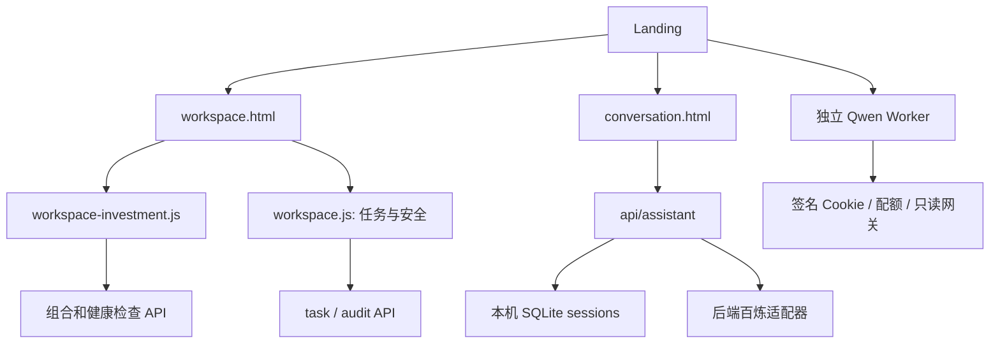

# 六模块架构审计与最小改造计划

日期：2026-10-24。只读核对后再修改；不更新 team-release，不改变共享后端权限或风险契约。

## 来源

- 个人预览 `preview`：`abcd197d370174ec475699d82eb5f27ffff8a820`，本轮开始时工作区干净。
- 团队工作分支 `codex/workspace-minimal-20261021`：`c24621726b0ba4d92795f2aa81a380a4c07f10d4`，本轮开始时工作区干净。
- 已刷新团队主分支：`46041e5526f97c0956798315d5caceb653615208`。未合并到当前分支，按不可变快照只读检查。
- 原始 F 盘工作区有大量用户历史改动，本轮不在该工作区写文件。

## 当前依赖

四个同页模块共用 `workspace.js` 的 hash 路由，但 `conversation.html` 使用自身布局与 sessionStorage；独立 Worker 拥有另一套签名会话。尚无六模块共享数据访问层。

| 模块 | 主要文件 | 数据与状态 | 缺口 |
| --- | --- | --- | --- |
| 工作台 | workspace.html、workspace.js | 当前目标仅在 DOM/变量；默认 #workspace | 刷新丢草稿，不能组合读取预算/持仓 |
| 投资组合 | workspace-investment.js、common.js、presentation.mjs | 组合快照、Core health-check，模块内 result | 本地8887未提供所需组合接口；无生活预算共享 |
| 生活与投资 | conversation.html、conversation.js、vendor/conversation/assistant | 独立 HttpOnly Cookie、SQLite账本/预算/偏好/对话；浏览器线程与草稿 | 独立侧栏，不能共享组合或跨模块建议任务 |
| 我的任务 | workspace.js、site-context.mjs、workspace-model.mjs | 仅记住一个 Core task_id；查询原任务和审计 | 对话与千问的 run_id 没有关联任务草案 |
| 安全与记录 | workspace.js | 同一 Core task_id 的事件投影；部分静态说明 | 未统一分析ID/来源快照/草案确认事件；不是完整账户权限系统 |
| 千问分析 | 独立Worker、听澜组件、conversation-20261024/provider.cjs | Worker签名会话与配额；本地百炼是另一分析入口 | 两套上下文；不能把授权和会话直接搬到前端 |

## 当前请求核对（不触发付费模型）

| 请求 | 结果 | 说明 |
| --- | --- | --- |
| 本机 /api/assistant/state | 200 JSON | 会话账本服务可用 |
| 本机 /api/demo/portfolio | 404 | 原投资组合模块不能从该服务读取组合 |
| 本机 /api/health-check/run GET | 404 | 原服务路由未转接，不表示团队实现不存在 |
| 本机 /api/audit/test | 404 | 本地未接Core任务审计 |
| 独立Worker /health | 200 | configured=true、qwen3.8-flash、PUBLIC；仅探活，不是本轮真实调用 |
| 独立Worker /investment-only/tinglan-config.json | 200 | SESSION + PUBLIC，保留服务端签名Cookie保护 |

上一轮 `conversation-20261024/evidence/live-browser.json` 已有本地真实 qwen3.8-flash HTTP200；本轮审计不重复付费。个人Pages的 conversation-config 与静态听澜config均 endpoint=null，不得宣称公网统一模型已连通。

## 可以复用的现有接口

团队main已具备 `/api/demo/portfolio`、`/api/health-check/run`、`/api/task/:id`、`/api/audit/:id`；模型工作流具备 `/api/review`、`/api/review/task/:id`、risk-dispatch、risk-callback、approval、simulate、cancel 等。复用前仍需 Owner 确认服务地址、签名方式和输入协议。不能将旧组合API、review-workflow和独立Risk工作台看成同一个契约。

`model-review.v1` 已支持 request_id、session_id、task_id、source_task_id、portfolio_snapshot_id、plan_id、plan_hash、policy_version、idempotency_key、context、data_mode；优先映射这些字段，不重复创造同义公共字段。

`owner-bridge.v1` 的 verified / HMAC_SHA256 是服务端鉴权证据；actor 文本、UI角色选择和浏览器本地存储均不赋予权限。独立Worker会拒绝未授权Origin并验证签名会话；它的CSP不允许被本机Shell任意iframe嵌入，不能以 iframe 或前端口令绕过。

## 最小分阶段实施

1. 审计与Contract提案：固化来源、能力矩阵和限制，提交待确认的统一服务与状态提案。
2. Shell与兼容：保留现有四模块DOM与逻辑，扩展现有hash路由；原生活页面作为同源内容组件复用，避免重写成熟编辑/记账逻辑；保留旧入口重定向兼容与DOM/草稿恢复。独立Worker仍走其原服务端权限流程。
3. 数据访问层：只读取现有服务响应，保留原始ID与来源；前端内部持久化的是草稿、来源引用和DEMO状态，不能伪装成服务端账户、正式任务或可信审计。用户角色未知时禁用授权动作。无接口时只能显式DEMO。
4. 分析上下文：用户显式选择来源并确认发送，冻结快照与来源时间；新只读分析入口及上下文绑定待Owner确认后实现。不把JSON上下文拼成记账消息，避免触发归档副作用。
5. 任务安全联动：正式风险与任务写入必须使用Owner签名响应和既有任务状态机；无可信risk结果只能“待审查”，执行永远关闭。允许演示草案闭环，但所有事件明确是浏览器DEMO，不能宣称满足正式RBAC/审计验收。
6. 验收：前端路由/存储单元检查、真实本地API读取、跨模块上下文、历史兼容、刷新/返回、移动端、既有生活记账回归。真实模型单独验收且不自动重试；生产风控与交易仍需Owner端独立验收。

## 不可用前端修补的部分

统一服务端身份与角色、跨系统任务ID映射、模型只读分析、风险签名回执、正式任务写入、审计关联与幂等，需要 `docs/contract-proposals/2026-10-24-unified-workspace.md` 的Owner确认。AGENTS.md要求新接口或字段先提交提案并等待确认；本轮不得擅自给后端新增接口或伪造ALLOW。
